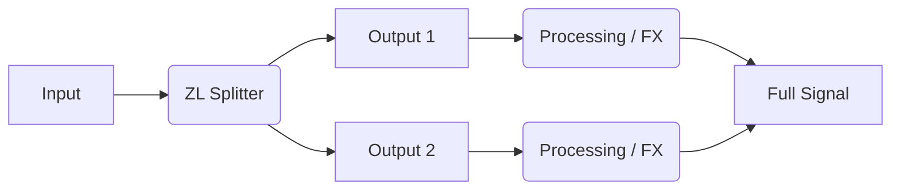
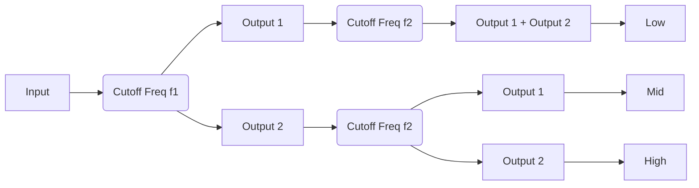

## About

ZL Splitter is a multifunctional audio splitter plugin with the following key features:

- **Versatile Separation**: Split audio into Left/Right, Mid/Side, Low/High, Transient/Steady, or Peak/Steady components, or run in pass-through mode.
- **Crossover Precision**: Low/High frequency splitting with de-cramped analog-matched IIR filters or linear-phase FIR filtering across 12, 24, and 48 dB/oct slopes.
- **Dynamic & Spectral Separation**: High-performance STFT median-filtering model for Transient/Steady separation and dynamic envelope follower for Peak/Steady separation.
- **Intuitive Workflow**: A carefully designed interface featuring an FFT spectrum analyzer with OCT and ERB smoothing, scrolling magnitude analyzer, and real-time waveform display.

The routing generally looks like the following:

## Top Panel

___

  
  

You can open the [UI Setting Panel](#ui-setting-panel) by clicking the logo.

___

  

You can open the [Preset Manager Panel](#preset-manager-panel) by clicking the icon.

___

**Split Type**

Selects the audio splitting mode from the dropdown menu:

-  `None`: Pass-through mode (Input to Output 1, silence to Output 2)
-  `Left Right`: Splits into Left (Output 1) and Right (Output 2) signals
-  `Mid Side`: Splits into Mid (Output 1) and Side (Output 2) signals
-  `Low High`: Splits into Low (Output 1) and High (Output 2) frequency bands
-  `Transient Steady`: Splits into Transient (Output 1) and Steady (Output 2) components
-  `Peak Steady`: Splits into Peak (Output 1) and Steady (Output 2) components

Parameter controls for the active split mode appear in the [Control Panel](#control-panel) on the left side of the analyzer.

___

  

Swaps Output 1 and Output 2.

___

**Output Legend**

Displays the current signal assignments and corresponding colors for Output 1 and Output 2 (or Input when split mode is set to `None`). When Output Swap is active, the labels reflect the swapped routing.

___

**`FFT`**

Selects the FFT spectrum analyzer.

___

**`MAG`**

Selects the magnitude analyzer.

___

**`WAV`**

Selects the waveform display.

___

  

Toggles visibility of the [Analyzer Setting Panel](#analyzer-setting-panel).

___

  

Toggles plugin bypass.

## Analyzer Setting Panel

The analyzer setting panel displays configuration options for the active analyzer mode (`FFT`, `MAG`, or `WAV`).

#### FFT Analyzer Settings

___

**`Min dB`**

Selects the minimum decibel floor for the FFT spectrum display.

- `-60 dB`
- `-72 dB`
- `-96 dB`
- `-120 dB`

___

**`Smooth`**

Selects the smoothing filter type and bandwidth for the frequency spectrum.

- Mode:
  - `OCT`: Octave smoothing (`1/24`, `1/12`, `1/6`, `1/3`, `1` oct)
  - `ERB`: Equivalent Rectangular Bandwidth smoothing (`1/4`, `1/2`, `1`, `2`, `4`)

___

**`Speed`**

Selects the decay speed of the spectrum curve.

- `Very Fast`
- `Fast`
- `Medium`
- `Slow`
- `Very Slow`

___

**`Tilt`**

Selects the spectral tilt slope added to the frequency response.

- `0 dB/oct`
- `1.5 dB/oct`
- `3 dB/oct`
- `4.5 dB/oct`
- `6 dB/oct`

#### Magnitude Analyzer Settings

___

**`Min dB`**

Selects the minimum decibel floor for the magnitude display.

- `-9 dB`
- `-18 dB`
- `-36 dB`
- `-54 dB`
- `-72 dB`
- `-90 dB`

___

**`Length`**

Selects the time duration displayed across the magnitude window.

- `6 s`
- `9 s`
- `12 s`
- `18 s`

___

**`Type`**

Selects the magnitude detection mode.

- `Peak`: Displays instantaneous peak magnitude
- `RMS`: Displays root-mean-square magnitude

___

**`Move`**

Selects the waveform scrolling mode.

- `Sync`: Synchronizes scrolling with host transport playback
- `Slow`: Continuously scrolls at a fixed readable pace
- `Roll`: Sweeps across the window like an oscilloscope roll display

#### Waveform Analyzer Settings

___

**`Max dB`**

Selects the maximum vertical decibel range for the waveform display.

- `0 dB`
- `-1 dB`
- `-2 dB`
- `-4 dB`
- `-8 dB`
- `-16 dB`

___

**`Length`**

Selects the time duration displayed across the waveform window.

- `6 s`
- `9 s`
- `12 s`
- `18 s`

## Center Panel

The center panel visualizes audio signals in real time according to the selected analyzer mode:

#### FFT Spectrum Analyzer

Displays the real-time frequency spectrum curves for Output 1 and Output 2 (or the full Input signal when split mode is set to `None`). Curves use the assigned Output 1 Color and Output 2 Color.

#### Magnitude Analyzer

Displays real-time scrolling magnitude curves over time for Output 1 and Output 2 (or Input).

#### Waveform Display

Displays filled real-time time-domain audio waveforms for Output 1 and Output 2 (or Input).

## Control Panel

The control panel is located on the left side of the plugin window. It provides parameters for the active split mode and automatically hides when split mode is set to `None`.

### Left/Right Split

___

**`Mix`**

Adjusts the cross-mix portion between the Left and Right signals. At `0%`, channels are completely separated (Left to Output 1, Right to Output 2). Increasing the mix blends channel content across outputs.

___

### Mid/Side Split

___

**`Mix`**

Adjusts the cross-mix portion between the Mid and Side signals. At `0%`, signals are cleanly separated into Mid (sum) and Side (difference). Increasing the mix introduces cross-bleed between Mid and Side outputs.

___

### Low/High Split

___

**`Mix`**

Cross-mixes the low and high frequency signals. At `0%`, low and high bands are fully separated.

___

**Filter Type**

Selects the crossover filter structure.

- `IIR`: Infinite Impulse Response crossover using de-cramped Linkwitz-Riley filters. Introduces zero algorithmic latency with flat magnitude response and analog-matched curves.
- `FIR`: Linear-phase Finite Impulse Response crossover using reverse IIR filtering. Preserves phase relationships without phase shifts, at the cost of processing latency.

> When set to `IIR`, the crossover introduces an allpass phase shift around the cutoff frequency. Avoid directly recombining the split outputs with an unaligned dry signal. If you do need to cascade `IIR` filters, see [Cascade IIR Filters](#cascade-iir-filters). If you require zero phase shift, use `FIR` mode.

___

**Filter Slope**

Selects the crossover slope:

- `12 dB/oct` (2nd-order Linkwitz-Riley)
- `24 dB/oct` (4th-order Linkwitz-Riley)
- `48 dB/oct` (8th-order Linkwitz-Riley)

___

**`Freq`**

Adjusts the crossover cutoff frequency between the low and high bands (`50 Hz` to `18 kHz`).

___

### Transient/Steady Split

Transient/Steady Split utilizes a short-time Fourier transform (STFT) 2D median filtering model to separate transient events from continuous steady tones in the frequency domain. They do not share parameters with Peak/Steady Split.

___

**`Balance`**

Adjusts the balance between transient and steady components (`-50` to `+50`). Negative values favor the steady component; positive values favor the transient component.

___

**`Strength`**

Adjusts the separation strength (`0%` to `100%`). At `0%`, no separation occurs; at `100%`, maximum separation is applied.

___

**`Hold`**

Adjusts the transient decay time (`0%` to `100%`). Higher values prolong transient decay, allowing sustained note attacks to remain in the transient signal.

___

**`Smooth`**

Adjusts spectral smoothness across frequency bins (`0%` to `100%`).
- At `0%`, frequency bins are split independently.
- At `100%`, the signal is split uniformly as a coherent spectral whole.

___

### Peak/Steady Split

Peak/Steady Split utilizes a dual-window dynamic envelope follower (compressor-like model) to separate sudden transient peaks from the underlying steady signal. They do not share parameters with Transient/Steady Split.

___

**`Balance`**

Adjusts the sensitivity threshold between peak and steady signals (`-50` to `+50`). Lower values retain more steady signal; higher values isolate peaks more aggressively.

___

**`Attack`**

Adjusts the onset response time for peak detection (`0%` to `100%`). Higher values slow the onset, letting initial transients pass into the steady signal; lower values engage peak detection immediately upon transient arrival.

___

**`Hold`**

Adjusts the release return time for the peak envelope (`0%` to `100%`). Higher values slow envelope decay, extending peak retention.

___

**`Smooth`**

Adjusts the averaging window sizes (`1` to `100`). Higher values smooth rapid dynamic fluctuations for more stable macro separation.

## UI Setting Panel

The UI setting panel controls analyzer colors, slider operations, etc. Components will be introduced in order from top to bottom.

#### Color

You can adjust the color by clicking on the left color block and change the transparency by dragging the right slider.

**`Text Color`**

**`Background Color`**

For better accessibility, please set Text/Background to colors with high contrast.

**`Shadow Color`**

**`Glow Color`**

**`Grid Color`**

**`Output 1 Color`**

**`Output 2 Color`**

**`Color Map 1`**

**`Color Map 2`**

#### Control

**`Wheel Sensitivity`**

- `Rough`: mouse-wheel sensitivity when `Shift` is not pressed
- `Fine`: mouse-wheel sensitivity when `Shift` is pressed
- `Menu`: mouse-wheel sensitivity when changing menu selections
- `Reverse`: whether to reverse the direction of the mouse wheel when `Shift` is pressed

**`Slider Sensitivity`**

- `Rough`: mouse-drag sensitivity when `Shift` is not pressed
- `Fine`: mouse-drag sensitivity when `Shift` is pressed

**`Dragger Sensitivity`**

- `Rough`: mouse-drag sensitivity when `Shift` is not pressed
- `Fine`: mouse-drag sensitivity when `Shift` is pressed

**`Rotary Slider Style`**

- `Circular`: A rotary control that you move by dragging the mouse in a circular motion, like a knob
- `Horizontal`: A rotary control that you move by dragging the mouse left-to-right
- `Vertical`: A rotary control that you move by dragging the mouse up-and-down
- `Horiz + Vert`: A rotary control that you move by dragging the mouse up-and-down or left-to-right
- `Distance`: the relative distance that the mouse has to move to drag the slider across the full extent of its range. It does not apply to the Circular style.

**`Slider Double Click`**

- `Return Default`: when you double-click the slider, it returns to the default value; when you double-click the slider with Ctrl/Command, it opens the value editor.
- `Open Editor`: when you double-click the slider, it opens the value editor; when you double-click the slider with Ctrl/Command, it returns to the default value.

___

#### Other

**`Refresh Rate`**

Set this to 1/n of your monitor refresh rate. For example,
- If your monitor refresh rate is 120 Hz, set it to 120 Hz, 60 Hz (1/2), or 30 Hz (1/4). DO NOT set it to 90 Hz.
- If your monitor refresh rate is 90 Hz, set it to 90 Hz or 30 Hz (1/3). DO NOT set it to 60 Hz.

**`FFT Quality`**

Selects the processing quality of the FFT analyzer.

- `Normal`
- `High`

**`FFT Setting`**

- `Tilt`: the extra tilting slope of the FFT
- `Speed`: the extra decay speed of the FFT

**`Combobox Alignment`**

- `Left`: combobox items are left-aligned
- `Center`: combobox items are center-aligned
- `Right`: combobox items are right-aligned

**`Curve Thickness`**

- `MAG`: Adjusts the thickness of the magnitude curve
- `FFT`: Adjusts the thickness of the FFT curve

**`Tooltip`**

Choose the tooltip language. It will take effect when the plugin window is reopened.

**`UI Scaling`**

Choose the font size mode.

- `Scale`: the font size scales with the window size. Controls the relative ratio.
- `Static`: the font size is fixed. Controls the actual font size.

**`Window Size Fix`**

Choose whether to turn on Window Size Fix.

- `Off`: plugin window size adjustments will be stored
- `On`: plugin window size adjustments will NOT be stored; instead, the window will open at its current size each time the plugin is opened. The size can still be changed, but the changes will not be stored.

___

#### Bottom Buttons

  

- Press: reveal the UI configuration folder (`ui.xml`)

___

  

- Press: reset settings on the current tab to defaults

___

  

- Press: save the current settings

___

  

- Press: discard all unsaved settings and close the UI setting panel

## Preset Manager Panel

The preset manager lets you save, organize, and delete presets.

___

**`Search Presets`**

Enter a preset name and search.

___

**`New Group`**

Enter a new group name and press `Enter` to save it.

___

**`New Preset`**

Enter a new preset name and press `Enter` to save it.

___

  

- Press: delete the selected preset group (along with all presets in the group) or the selected preset

___

  

- Press: reveal the preset folder

## UI Controls

Generally, you can enable fine adjustment with `Shift` and enable special adjustment with `Ctrl/Command`. If the direction of the mouse wheel is reversed when `Shift` is pressed, you can reverse it again (in the UI Setting Panel) to put it back to normal.

**Sliders**

- You can enable fine adjustment with `Shift` when using the mouse to drag / the mouse wheel to adjust sliders.
- You can use the left/right mouse button to control the first/second value when there are two values on the slider.

**Combobox**

- You can use the mouse wheel to change the selected item.

**Parameter Context Menu**

- In supported hosts, right-clicking any plugin parameter control opens the host context menu (e.g., for automation assignment or parameter display).

**Window Size**

- You can drag the resize handle at the bottom-right corner to adjust the plugin window size.
- Recommended way to set Window Size:
	1. Set **Window Size Fix** to `OFF` and press the store button.
	2. Adjust the plugin window to the size you prefer.
	3. Close the plugin window.
	4. Reopen the plugin window.
	5. Set **Window Size Fix** to `ON` and press the store button.
	6. Close the plugin window.
	7. Then, the plugin will open with the window size set in Step 2 every time.

## Cascade IIR Filters

When cascading multiple Low/High `IIR` filters (for example, to construct a three-band splitter), phase shifts between branches must be aligned to preserve complementary summation:

