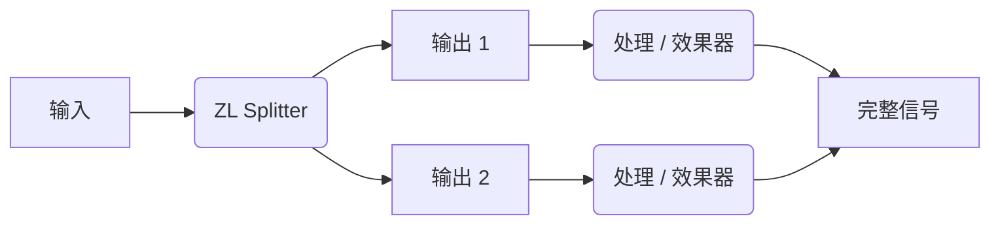
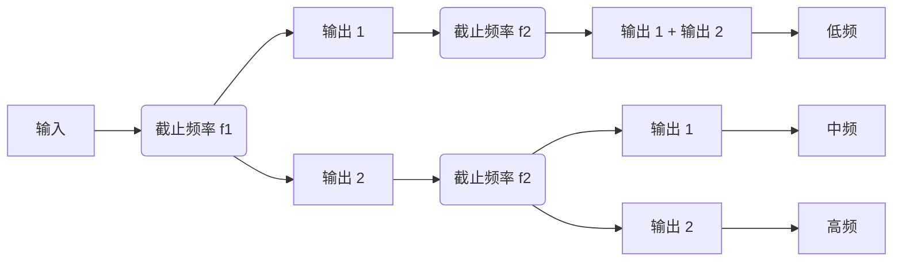

## 关于

ZL Splitter 是一款多功能音频分离插件，具有以下主要特性：

- **多功能分离**：将音频信号分离为左/右声道、中/侧声道、低频/高频、瞬态/稳态或峰值/稳态分量，亦可运行于直通模式。
- **高精度分频**：低频/高频分离采用模拟匹配去曲解（de-cramped）IIR 滤波器或线性相位 FIR 滤波，提供 12、24 和 48 dB/oct 斜率。
- **动态与频谱分离**：基于 STFT 中值滤波模型的瞬态/稳态分离，以及基于动态包络跟随器的峰值/稳态分离。
- **直观工作流**：精心设计的界面包含支持 OCT 与 ERB 平滑的 FFT 频谱分析仪、实时滚动幅值分析仪以及波形显示。

信号路由通常如下所示：

## 顶部面板

___

  
  

你可以通过点击标志来打开 [界面设置面板](#界面设置面板)。

___

  

你可以通过点击图标来打开 [预设管理器面板](#预设管理器面板)。

___

**分离模式（Split Type）**

在下拉菜单中选择音频分离模式：

-  `None`：直通模式（输入 -> 输出 1，静音 -> 输出 2）
-  `Left Right`：分离为左声道（输出 1）与右声道（输出 2）
-  `Mid Side`：分离为中声道（输出 1）与侧声道（输出 2）
-  `Low High`：分离为低频（输出 1）与高频（输出 2）频段
-  `Transient Steady`：分离为瞬态（输出 1）与稳态（输出 2）分量
-  `Peak Steady`：分离为峰值（输出 1）与稳态（输出 2）分量

当前激活分离模式的参数控制项将显示在分析仪左侧的 [控制面板](#控制面板) 中。

___

  

交换 Output 1 和 Output 2。

___

**输出图例（Output Legend）**

显示当前分配给输出 1 和输出 2 的信号名称及对应颜色（当分离模式为 `None` 时显示 Input）。当交换输出开启时，标签将相应反映交换后的路由。

___

**`FFT`**

选择 FFT 频谱分析仪。

___

**`MAG`**

选择幅值分析仪。

___

**`WAV`**

选择波形显示。

___

  

切换 [分析仪设置面板](#分析仪设置面板) 的显示/隐藏。

___

  

开启/关闭插件旁通。

## 分析仪设置面板

分析仪设置面板显示当前激活分析仪模式（`FFT`、`MAG` 或 `WAV`）的配置选项。

#### FFT 分析仪设置

___

**`Min dB`（最小分贝）**

选择 FFT 频谱显示的最小分贝底限。

- `-60 dB`
- `-72 dB`
- `-96 dB`
- `-120 dB`

___

**`Smooth`（平滑）**

选择频谱的平滑滤波器类型与带宽。

- 模式：
  - `OCT`：倍频程平滑（`1/24`、`1/12`、`1/6`、`1/3`、`1` oct）
  - `ERB`：等效矩形带宽平滑（`1/4`、`1/2`、`1`、`2`、`4`）

___

**`Speed`（衰减速度）**

选择频谱曲线的释放衰减速度。

- `Very Fast`（极快）
- `Fast`（快）
- `Medium`（中等）
- `Slow`（慢）
- `Very Slow`（极慢）

___

**`Tilt`（倾斜斜率）**

选择添加到频谱响应中的额外倾斜斜率。

- `0 dB/oct`
- `1.5 dB/oct`
- `3 dB/oct`
- `4.5 dB/oct`
- `6 dB/oct`

#### 幅值分析仪设置

___

**`Min dB`（最小分贝）**

选择幅值显示的最小分贝底限。

- `-9 dB`
- `-18 dB`
- `-36 dB`
- `-54 dB`
- `-72 dB`
- `-90 dB`

___

**`Length`（显示时长）**

选择幅值窗口显示的时间跨度。

- `6 s`
- `9 s`
- `12 s`
- `18 s`

___

**`Type`（幅值类型）**

选择幅值检测模式。

- `Peak`：显示瞬时峰值幅值
- `RMS`：显示均方根（RMS）幅值

___

**`Move`（移动模式）**

选择波形滚动移动模式。

- `Sync`：与宿主走带播放同步滚动
- `Slow`：以固定的适读速度持续滚动
- `Roll`：如同示波器般横向扫过窗口

#### 波形分析仪设置

___

**`Max dB`（最大分贝）**

选择波形显示的垂直最大分贝范围。

- `0 dB`
- `-1 dB`
- `-2 dB`
- `-4 dB`
- `-8 dB`
- `-16 dB`

___

**`Length`（显示时长）**

选择波形窗口显示的时间跨度。

- `6 s`
- `9 s`
- `12 s`
- `18 s`

## 中央面板

中央面板根据当前选择的分析仪模式实时可视化音频信号：

#### FFT 频谱分析仪

实时显示输出 1 与输出 2（或分离模式设为 `None` 时的完整输入信号）的频谱曲线。曲线颜色对应输出 1 颜色与输出 2 颜色。

#### 幅值分析仪

实时显示输出 1 与输出 2（或输入信号）随时间变化的滚动幅值曲线。

#### 波形显示

实时显示输出 1 与输出 2（或输入信号）的填充时域音频波形。

## 控制面板

控制面板位于插件窗口左侧。它提供当前激活分离模式的特定参数，并在分离模式为 `None` 时自动隐藏。

### 左/右声道分离

___

**`Mix`（混合）**

调节左声道与右声道之间的交叉混合比例。在 `0%` 时，声道完全分离（左声道至输出 1，右声道至输出 2）。增加混合比例会使声道内容在两路输出间互相渗透。

___

### 中/侧声道分离

___

**`Mix`（混合）**

调节中声道与侧声道之间的交叉混合比例。在 `0%` 时，信号被纯净分离为中声道（和信号）与侧声道（差信号）。增加混合比例会引入中声道与侧声道之间的交叉串音。

___

### 低频/高频分离

___

**`Mix`（混合）**

交叉混合低频与高频信号。在 `0%` 时，低频与高频频段完全分离。

___

**滤波器类型（Filter Type）**

选择分频滤波器结构。

- `IIR`：无限冲激响应分频器，使用去曲解（de-cramped）Linkwitz-Riley 滤波器。具有零算法延迟、平坦的幅值响应以及模拟匹配的曲线特性。
- `FIR`：线性相位有限冲激响应分频器，使用时间反转 IIR 滤波。完全保持相位关系而不产生相位偏移，但会带来处理延迟。

> 当设置为 `IIR` 时，分频器会在截止频率附近引入全通相位偏移。请避免直接将分离输出与未对齐的原干声信号混合。如果确实需要级联 `IIR` 滤波器，请参考 [级联 IIR 滤波器](#级联-iir-滤波器)。如果需要零相位偏移，请使用 `FIR` 模式。

___

**滤波器斜率（Filter Slope）**

选择分频滤波器的斜率：

- `12 dB/oct`（2 阶 Linkwitz-Riley）
- `24 dB/oct`（4 阶 Linkwitz-Riley）
- `48 dB/oct`（8 阶 Linkwitz-Riley）

___

**`Freq`（截止频率）**

调节低频与高频频段之间的分频截止频率（`50 Hz` 至 `18 kHz`）。

___

### 瞬态/稳态分离

瞬态/稳态分离采用短时傅立叶变换（STFT）二维中值滤波模型，在频域中将瞬态事件与持续稳态音色分离开来。与峰值/稳态分离不共享参数。

___

**`Balance`（平衡）**

调节瞬态与稳态分量之间的平衡（`-50` 至 `+50`）。负值偏向稳态分量；正值偏向瞬态分量。

___

**`Strength`（强度）**

调节分离强度（`0%` 至 `100%`）。在 `0%` 时不进行分离；在 `100%` 时应用最大分离。

___

**`Hold`（保持）**

调节瞬态衰减时间（`0%` 至 `100%`）。数值越大，瞬态衰减越慢，保留在瞬态信号中的音符起音部分越长。

___

**`Smooth`（平滑）**

调节跨频段的频谱平滑度（`0%` 至 `100%`）。
- 为 `0%` 时，各频率 bin 相对独立地进行分离。
- 为 `100%` 时，信号被作为一个统一的频谱整体进行平滑分离。

___

### 峰值/稳态分离

峰值/稳态分离采用双时间窗口动态包络跟随器（类似压缩器的模型），将突发的瞬态峰值从持续的基础信号中分离出来。与瞬态/稳态分离不共享参数。

___

**`Balance`（平衡）**

调节峰值与稳态信号之间的灵敏度阈值（`-50` 至 `+50`）。数值越低保留的稳态信号越多；数值越高捕获峰值越激进。

___

**`Attack`（启动）**

调节峰值检测的启动响应时间（`0%` 至 `100%`）。数值越大启动越慢，使初始瞬态渗入稳态信号中；数值越小在瞬态到达时立即触发峰值检测。

___

**`Hold`（保持）**

调节峰值包络的释放恢复时间（`0%` 至 `100%`）。数值越大包络衰减越慢，峰值保持时间越长。

___

**`Smooth`（平滑）**

调节平均窗口大小（`1` 至 `100`）。数值越大越能平滑快速的动态波动，获得更稳定的宏观分离效果。

## 界面设置面板

界面设置面板用于控制分析仪颜色、滑块操作等。组件将从上到下依次介绍。

#### 颜色

你可以通过点击左侧色块来调整颜色，并通过拖动右侧滑块来改变透明度。

**`Text Color`（文本颜色）**

**`Background Color`（背景颜色）**

为了更好的无障碍体验，请将文本/背景设置为对比度高的颜色。

**`Shadow Color`（阴影颜色）**

**`Glow Color`（发光颜色）**

**`Grid Color`（网格颜色）**

**`Output 1 Color`（输出 1 颜色）**

**`Output 2 Color`（输出 2 颜色）**

**`Color Map 1`（颜色映射 1）**

**`Color Map 2`（颜色映射 2）**

#### 控制

**`Wheel Sensitivity`（滚轮灵敏度）**

- `Rough`：未按下 `Shift` 时的鼠标滚轮灵敏度
- `Fine`：按下 `Shift` 时的鼠标滚轮灵敏度
- `Menu`：调节下拉框选项时的鼠标滚轮灵敏度
- `Reverse`：按下 `Shift` 时是否反转鼠标滚轮的方向

**`Slider Sensitivity`（滑块灵敏度）**

- `Rough`：未按下 `Shift` 时的鼠标拖拽灵敏度
- `Fine`：按下 `Shift` 时的鼠标拖拽灵敏度

**`Dragger Sensitivity`（拖拽灵敏度）**

- `Rough`：未按下 `Shift` 时的拖拽灵敏度
- `Fine`：按下 `Shift` 时的拖拽灵敏度

**`Rotary Slider Style`（旋钮滑块样式）**

- `Circular`：通过鼠标进行圆周运动来拖动的旋钮控件
- `Horizontal`：通过鼠标左右拖动的旋钮控件
- `Vertical`：通过鼠标上下拖动的旋钮控件
- `Horiz + Vert`：通过鼠标上下或左右拖动的旋钮控件
- `Distance`：鼠标在整个范围内拖动滑块所需移动的相对距离。它不适用于 `Circular` 样式。

**`Slider Double Click`（滑块双击）**

- `Return Default`：当你双击滑块时，它将返回默认值；当你按住 Ctrl/Command 双击滑块时，将打开数值编辑器。
- `Open Editor`：当你双击滑块时，它将打开数值编辑器；当你按住 Ctrl/Command 双击滑块时，将返回默认值。

___

#### 其他

**`Refresh Rate`（刷新率）**

请将此设置为显示器刷新率的 1/n。例如：
- 如果你的显示器刷新率是 120 Hz，将其设置为 120 Hz、60 Hz（1/2）或 30 Hz（1/4）。不要设置为 90 Hz。
- 如果你的显示器刷新率是 90 Hz，将其设置为 90 Hz 或 30 Hz（1/3）。不要设置为 60 Hz。

**`FFT Quality`（FFT 质量）**

选择 FFT 分析仪的处理质量。

- `Normal`（正常）
- `High`（高）

**`FFT Setting`（FFT 设置）**

- `Tilt`：控制（额外的）FFT 倾斜斜率
- `Speed`：控制（额外的）FFT 衰减速度

**`Combobox Alignment`（下拉框对齐方式）**

- `Left`：下拉框选项居左对齐
- `Center`：下拉框选项居中对齐
- `Right`：下拉框选项居右对齐

**`Curve Thickness`（曲线粗细）**

- `MAG`：调节幅值曲线的粗细
- `FFT`：调节 FFT 曲线的粗细

**`Tooltip`（工具提示）**

选择工具提示语言。重新打开插件窗口时生效。

**`UI Scaling`（界面缩放）**

选择字体大小模式。

- `Scale`：字体大小随窗口大小缩放。控制相对比例。
- `Static`：字体大小固定。控制实际字体大小。

**`Window Size Fix`（窗口大小固定）**

选择是否开启窗口大小固定。

- `Off`：插件窗口大小调整将被保存
- `On`：插件窗口大小调整将不会被保存，但每次打开插件时都会保持当前的大小。窗口大小依然可以被调整，但这些调整不会被保存。

___

#### 底部按钮

  

- 按下：打开界面配置文件所在文件夹（`ui.xml`）

___

  

- 按下：重置当前标签页中的设置为默认值

___

  

- 按下：保存当前设置

___

  

- 按下：舍弃所有未保存设置并关闭界面设置面板

## 预设管理器面板

预设管理器让你可以保存、整理和删除预设。

___

**`Search Presets`（搜索预设）**

输入预设名称并进行搜索。

___

**`New Group`（新建分组）**

输入新分组名称并按下 `Enter` 键以保存。

___

**`New Preset`（新建预设）**

输入新预设名称并按下 `Enter` 键以保存。

___

  

- 按下：删除选中的预设分组（以及该分组中的所有预设）或选中的预设

___

  

- 按下：打开预设文件夹

## 界面控制

通常，你可以通过 `Shift` 开启精细调节，通过 `Ctrl/Command` 开启特殊调节。如果在按下 `Shift` 时鼠标滚轮方向被反转，你可以再次反转它（在界面设置面板中）以将其恢复正常。

**滑块**

- 在使用鼠标拖动或鼠标滚轮调节滑块时，可以通过 `Shift` 开启精细调节。
- 当滑块上有两个值时，可以使用鼠标左/右键来控制第一个/第二个值。

**下拉框**

- 可以使用鼠标滚轮来更改选择项。

**参数上下文菜单**

- 在支持的宿主中，右键点击任意插件参数控件可打开宿主上下文菜单（例如用于自动化分配或参数显示）。

**窗口大小**

- 可以拖动右下角的调整手柄来调整插件窗口大小。
- 推荐的窗口大小设置方法：
	1. 将 **Window Size Fix**（窗口大小固定）设置为 `OFF` 并点击保存按钮。
	2. 将插件窗口调整到你偏好的大小。
	3. 关闭插件窗口。
	4. 重新打开插件窗口。
	5. 将 **Window Size Fix**（窗口大小固定）设置为 `ON` 并点击保存按钮。
	6. 关闭插件窗口。
	7. 之后，插件每次打开时都将使用在步骤 2 中设置的窗口大小。

## 级联 IIR 滤波器

当级联多个低频/高频 `IIR` 滤波器时（例如构建三频段分频器），必须对齐分支之间的相位偏移以保持互补求和：

